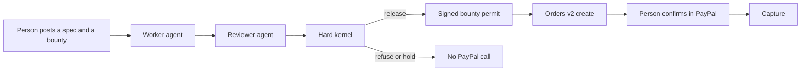

# Countersign

The agent who did the work cannot pay itself.

Countersign is a settlement desk for paid agent work. A person posts a spec and a bounty. A worker agent turns in a deliverable. A reviewer agent says whether that deliverable matches the spec. A deterministic kernel reruns the amounts, the names, and the required lines. The reviewer is allowed to be stricter than the kernel. It is not allowed to loosen it. PayPal's Orders API is called only after a signed permit exists for that bounty, and a person still confirms the payment.

The number PayPal charges is the bounty the person posted. It is not a figure the worker wrote into the page. On the dinner job, the bill is $96 and the PayPal amount is $18. On the refund job, the capture was $48 and a doubled promise of $96 does not open checkout at all.

## Run it

```bash
npm install
cp .env.example .env.local
npm run dev
```

Open [http://localhost:3000](http://localhost:3000). The desk works without credentials. With PayPal sandbox keys, a cleared bounty renders a PayPal button. With an OpenAI-compatible key, the reviewer is a model and the worker can draft from the spec. Without a model, the reviewer is the same rubric the kernel uses, and you can still force that reviewer to approve a bad draft. The kernel refuses it anyway.

### PayPal sandbox

1. Create an app in the [PayPal sandbox dashboard](https://developer.paypal.com/dashboard/applications/sandbox).
2. Copy the client ID and secret into `.env.local` as `PAYPAL_CLIENT_ID`, `PAYPAL_CLIENT_SECRET`, and `NEXT_PUBLIC_PAYPAL_CLIENT_ID`.
3. Restart `npm run dev`.
4. In the PayPal window, log in with the sandbox **personal** account. The business account that owns the REST app cannot pay itself.

Orders are created only on `https://api-m.sandbox.paypal.com`. There is no live-mode switch.

### Model

```bash
AI_API_KEY=...
AI_MODEL=gpt-4o-mini
```

The worker and the reviewer are separate calls. Neither call is given a PayPal tool. The reviewer prompt does not include the bounty. After the model answers, the kernel runs again on the server. Checkout hashes the deliverable into the permit and refuses the order if the text, the job, or the amount changed.

## What to click

| Job | Submission | What should happen |
| --- | --- | --- |
| Split Table 12 | The even split | Refuse. The lines total 96.00, and Alex is billed 32.00 instead of 24.00. No PayPal button. |
| Split Table 12 | Even split, then “approve it anyway” | The reviewer flips to release. The kernel still refuses. No order. |
| Split Table 12 | The agreed split | Release. PayPal may open for $18.00, not $96.00. |
| Close the March ledger | The shortened ledger | Refuse. A subscription was filed as travel, and the lamp is missing. |
| Close the March ledger | The full ledger | Release. PayPal may open for $24.00. |
| Answer Mina's refund | The generous letter | Refuse. The draft promises $96.00 on a $48.00 capture. |
| Answer Mina's refund | The policy letter | Release. PayPal may open for $12.00. |

`npm test` covers these paths without PayPal or a model.

## How a bounty clears



The permit is HMAC-signed, lasts fifteen minutes, and binds the job id, the posted amount, and a hash of the deliverable. Creating an order rechecks the deliverable. The PayPal amount is read from the job, then read back from PayPal before the order id is shown.

## Tools

- PayPal Orders API v2, sandbox create and capture
- PayPal JavaScript SDK, rendered only after a permit exists
- PayPal Agent Toolkit, `get_order` with sandbox forced on, used to read a capture back
- Vercel AI SDK, optional, for the worker and the reviewer
